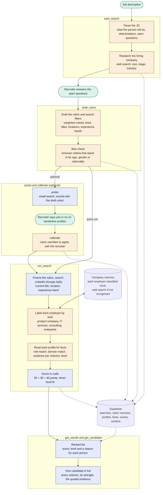

# Talent Finder

MCP server for Claude Code. Job description in, ranked LinkedIn candidates out, with the evidence behind every score.

The model extracts facts. Code decides the score.

## Architecture



Amber: model. Blue: code. Green: recruiter.

## Scoring

One model call per profile reports five facts. Code turns them into a score out of 100.

| Fact | Effect on the score |
|---|---|
| Role match, 0 to 4 | up to 30 points |
| Domain match, 0 to 4 | up to 30 points |
| Evidence per criterion, 0 to 4, with quotes | up to 40 points, weighted by criterion |
| Level, entry to principal | × 1.0 same level, 0.75 one off, 0.4 two off, 0.2 further |
| Employers comparable | × 0.6 if not, only when the recruiter restricts employers |

A contradicted deal-breaker scores 0. Level is judged from scope and kind of employer, not years. Internships are left out.

## Tools

| Tool | What it does |
|---|---|
| `start_search` | Parses the JD, researches the company with a web search, returns open questions |
| `draft_rubric` | Drafts the rubric and search filters, runs the bias check, returns search cost |
| `probe` | Small search; returns borderline profiles to judge (optional) |
| `calibrate` | Revises the rubric from the recruiter's yes or no (optional) |
| `run_search` | Freezes the rubric and runs the full search in the background |
| `get_results` | Waits for the search, returns the ranked list |
| `get_candidate` | Every criterion, its strength and the quoted evidence for one person |

## Setup

```
cp .env.example .env
psql "$SUPABASE_DB_URL" -f schema.sql
uv run --env-file .env --with pytest pytest tests/test_score.py
```

Open Claude Code in this folder; `.mcp.json` registers the server. Paste a job description and ask for candidates. `samples/` has twenty.

## Code

| File | Responsibility |
|---|---|
| `talent/server.py` | The seven MCP tools |
| `talent/pipeline.py` | One function per tool |
| `talent/jd.py` | Parse the job description |
| `talent/company.py` | Research the hiring company |
| `talent/rubric.py` | Draft, bias-check and revise the rubric |
| `talent/search.py` | Search LinkedIn through Apify |
| `talent/employers.py` | Company memory: the kind of each employer |
| `talent/score.py` | Read a profile for facts; scoring arithmetic |
| `talent/llm.py`, `talent/db.py` | Model calls and database connections |
| `schema.sql` | Searches, rubric versions, profiles, scores, verdicts, employers |

## Benchmark

20 real roles, 320 LinkedIn profiles. Reference: a stronger model ranking each role's profiles twice in shuffled order. Full output in `benchmark/results.txt`.

| Way of ranking | Rank agreement | Top-5 quality |
|---|---|---|
| Model gives one score per profile | 0.86 | 0.96 |
| Model ranks the whole list | 0.85 | 0.96 |
| This pipeline | 0.65 | 0.89 |
| Embedding similarity | 0.43 | 0.84 |
| Keywords and years | 0.29 | 0.79 |

A single model score ranks better. This pipeline trades some accuracy for scores that can be explained, reproduced and calibrated.

Profiles and judge rankings are cached locally and not committed. A fresh run searches LinkedIn again and spends Apify credit.

## Limits

- The reference is a model. The only human check is ten verdicts on one role.
- The 30 / 30 / 40 weights are untuned.
- Calibration has only been run with stand-in verdicts.
- An empty search is not widened.
- Web search (hiring company, unrecognised employers) needs an endpoint with the `web_search` tool. Without one, company research falls back to the JD and website text and those employers stay unknown.
- Free Apify accounts: 25 profiles a run, 10 runs.
