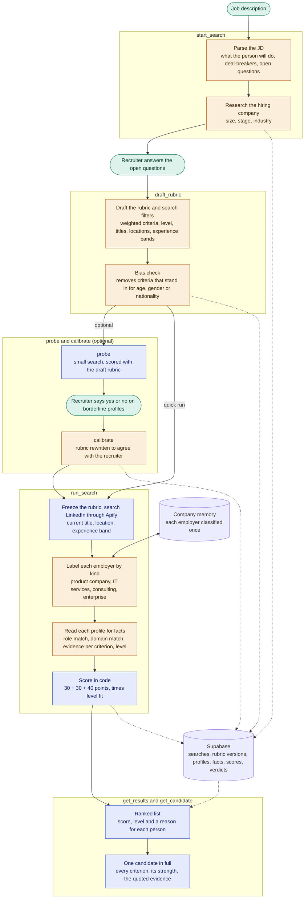

# Talent Finder

An MCP server for Claude Code. Give it a job description and it finds people on LinkedIn,
reads each profile, and returns a ranked list with the evidence behind every score.

## Architecture

One rule shapes the design: **the model extracts facts, and code decides the score.** The
model reads text and reports what it finds. Searching, storing and the arithmetic that ranks
people are ordinary code, so any score can be explained and worked out again by hand.



Amber steps are done by the model, blue by code, green by the recruiter.

### The steps

1. **Parse the JD** for what the person will do, the real deal-breakers, and the gaps worth
   asking the recruiter about.
2. **Research the hiring company**, because candidates are levelled against it.
3. **Draft a rubric and search filters**, then run a bias check over the criteria.
4. **Probe and calibrate** (optional): a small search, then the recruiter's yes or no on
   borderline profiles rewrites the rubric.
5. **Search LinkedIn** through Apify by current title, location and experience band.
6. **Label each employer by kind** (product company, IT services, consulting, enterprise).
   Each company is classified once and remembered, so two candidates from the same company
   are always read the same way.
7. **Read each profile** with one model call that reports facts only.
8. **Score in code**, then return the ranked list and, on request, the evidence for one person.

### How a profile is scored

The model reports five facts per profile. Code turns them into a score out of 100.

| Fact the model reports | What code does with it |
|---|---|
| Role match, 0 to 4: how close their recent work is to the job | up to 30 points |
| Domain match, 0 to 4: how close their employers' industry is | up to 30 points |
| Evidence for each criterion, 0 to 4, with the profile's words quoted | up to 40 points, weighted by criterion |
| Level, entry to principal, judged from scope and kind of employer | multiplies the total: 1.0 same level, 0.75 one off, 0.4 two off, 0.2 further |
| Whether their employers compare | multiplies by 0.6 when they do not, only if the recruiter restricted employers |

A profile that contradicts a deal-breaker scores 0. A profile that is silent on one is kept and
flagged for a person to verify. Level is never read from years alone, and internships are left out.

### What is stored

Everything a search produces is kept in Postgres (`schema.sql`), so a ranking can be reproduced.

| Table | Holds |
|---|---|
| `app.searches` | The job description, its parsed form and the hiring company |
| `app.rubrics` | Every version of a search's rubric; a full run freezes one |
| `app.profiles` | LinkedIn profiles, trimmed to what a recruiter reads |
| `app.scores` | The facts read off each profile and the score computed from them |
| `app.calibrations` | The recruiter's yes or no on probe profiles |
| `app.employers` | Company memory: the kind of each employer |

### Code layout

| File | Responsibility |
|---|---|
| `talent/server.py` | The seven MCP tools |
| `talent/pipeline.py` | One function per tool: load state, do a step, save, summarise |
| `talent/jd.py` | Parse the job description |
| `talent/company.py` | Research the hiring company |
| `talent/rubric.py` | Draft the rubric, check it for bias, revise it from verdicts |
| `talent/search.py` | Search LinkedIn through Apify and trim profiles |
| `talent/employers.py` | Company memory |
| `talent/score.py` | Read a profile for facts, and the scoring arithmetic |
| `talent/llm.py`, `talent/db.py` | The one place model calls and database connections are made |

## Setup

```
cp .env.example .env                       # fill in the keys
psql "$SUPABASE_DB_URL" -f schema.sql
uv run --env-file .env --with pytest pytest tests/test_score.py
```

`.mcp.json` registers the server, so opening Claude Code in this folder is enough. Then paste a
job description and ask it to find candidates. `samples/` has twenty real ones to try.

## Tools

| Tool | What it does |
|---|---|
| `start_search` | Parses the JD and researches the company. Returns the open questions. |
| `draft_rubric` | Drafts the rubric and filters from the recruiter's answers. Returns what a search would cost. |
| `probe` | Small search, returns borderline profiles to judge. |
| `calibrate` | Revises the rubric from the recruiter's verdicts. |
| `run_search` | Freezes the rubric and runs the full search in the background. |
| `get_results` | Waits for a running search, then returns the ranked list. |
| `get_candidate` | Every criterion, its strength and the quoted evidence for one person. |

## Benchmark

`benchmark/run.py` ranks the same profiles five ways and compares each with a stronger model
that ranks every role's profiles from the full JD, twice, in shuffled order. On 20 real roles
and 320 LinkedIn profiles:

| Way of ranking | Rank agreement | Top-5 quality |
|---|---|---|
| Model gives one score per profile | 0.86 | 0.96 |
| Model ranks the whole list | 0.85 | 0.96 |
| This pipeline | 0.65 | 0.89 |
| Embedding similarity | 0.43 | 0.84 |
| Keywords and years | 0.29 | 0.79 |

Asking a model for a single score ranks better. This pipeline keeps the model to extracting
facts and lets code decide, so that every score can be explained and reproduced, and so that a
recruiter's feedback has something to change. The benchmark keeps the simpler approaches as
the bar to close. `benchmark/results.txt` has the full output, role by role.

The profiles and the judge's rankings are cached locally and are not in this repository,
because they are real people's data. A fresh run searches LinkedIn again, which spends Apify credit.

## Limits

- The reference is a model. The only human check is ten yes or no verdicts on one role.
- The 30 / 30 / 40 weights are a first choice and have not been tuned.
- Calibration has been run with stand-in verdicts, not yet with a working recruiter.
- A search that finds nobody is not widened automatically.
- Free Apify accounts allow 25 profiles a run and 10 runs of the search actor.
